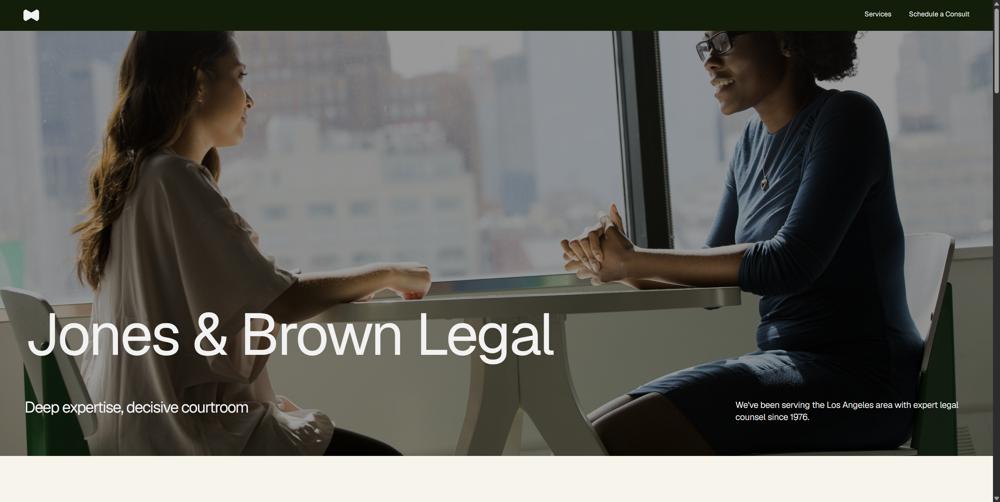
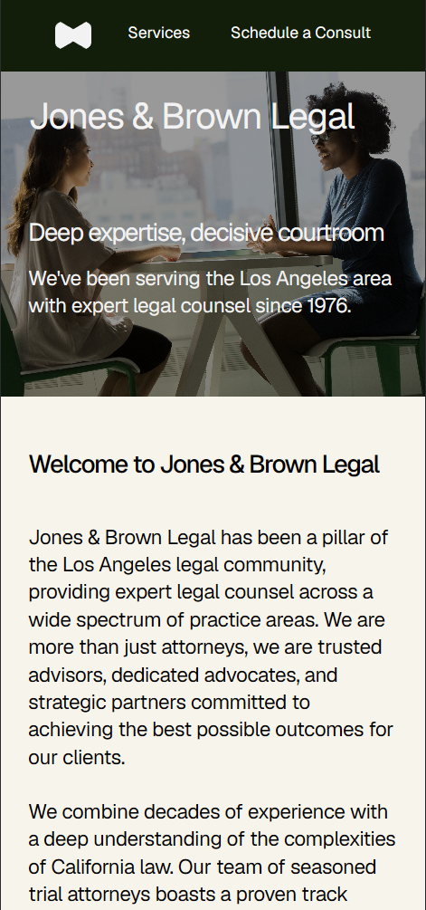

# Legal Services
Website created by following a figma design, the technologies that were used are html / tailwind css / js. Website used semantic html and responsive css at 3 different sizes. JS was used to create testimonal slider with the use of data attributes for JS

## Live Demo
[View Live Demo] ()

## Screenshots
- Desktop Design

- Mobile Design

## Features

- Fully Responsive design
- Testimonial Functional Slider
- Clean modern design following figma template

## Technologies Used

- HTML5
- Tailwind CSS
- JavaScript